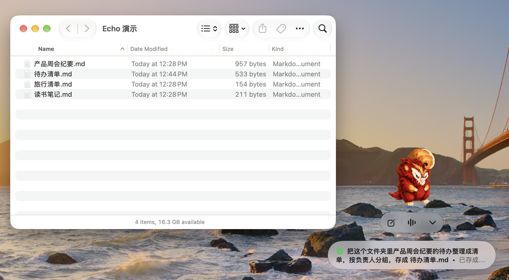
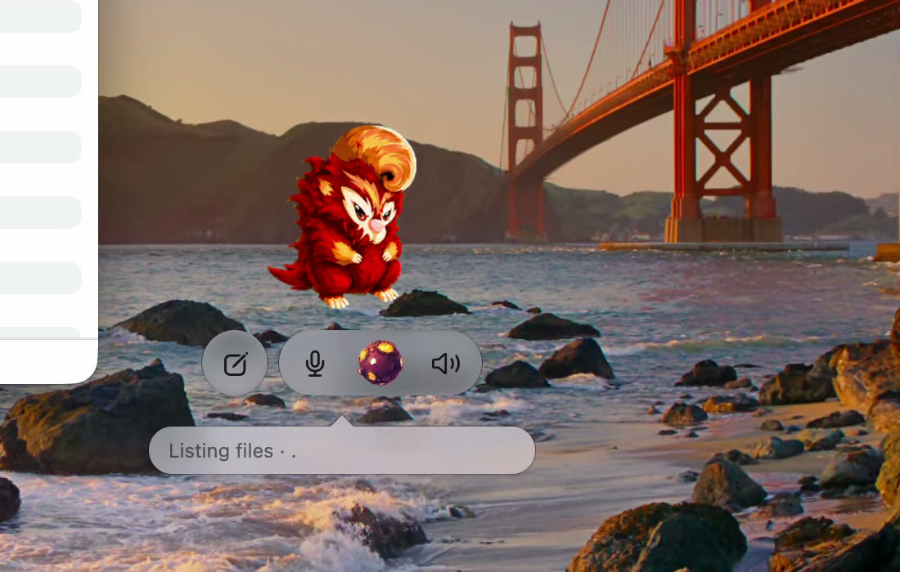
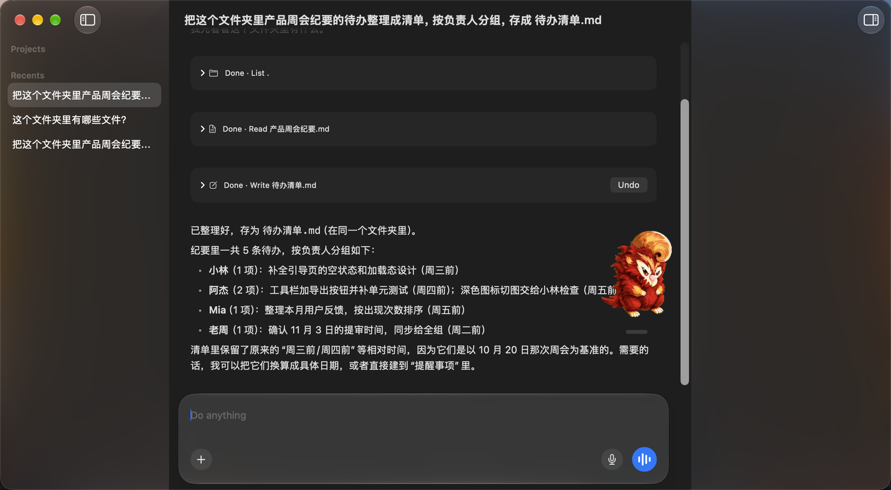
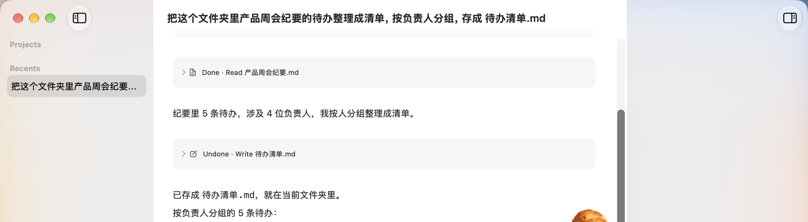
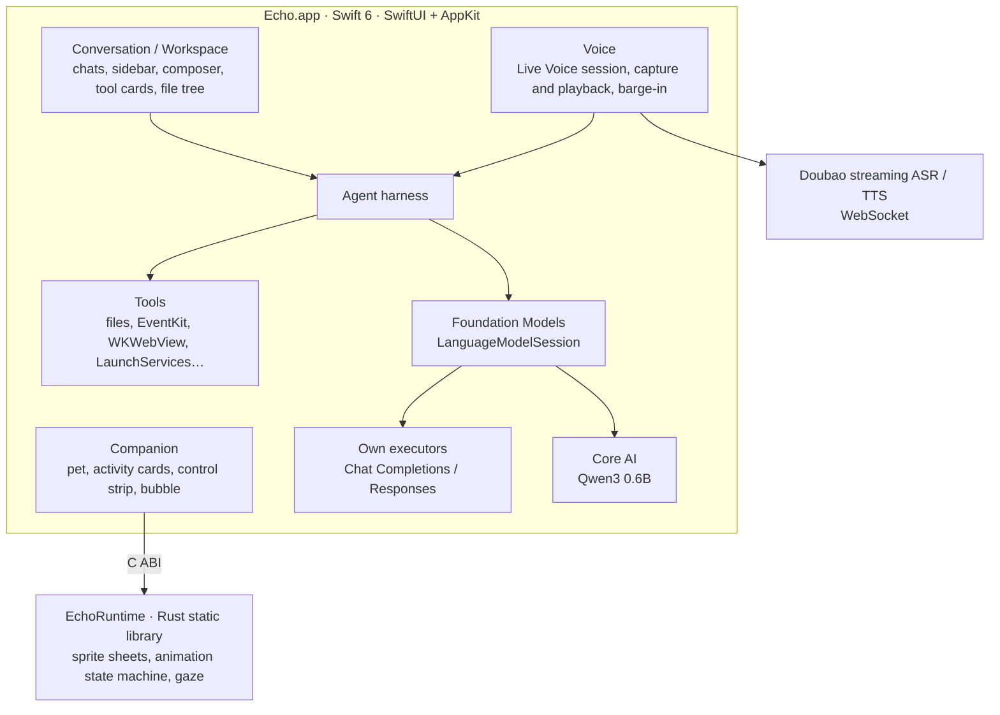

# Echo

[简体中文](README.md) | English

Echo is a native macOS desktop pet and a lightweight Agent for everyday use. Its interface is written in SwiftUI and AppKit, and a small Rust runtime drives the pet's animations.

It lives in a corner of your desktop: it turns to follow your pointer and waves when you click it. Hand it a task and it does the work with its tools in the background, then puts the result on a card next to the pet. When you'd rather talk, start a Live Voice call and keep the conversation going by voice.



<!-- Video placeholder: 30–60 second demo -->
> 🎬 Demo video coming soon: `docs/media/demo-en.mp4`

---

## Two ways to use it

**1. Hand off a task and let it finish in the background**

Click Start new chat on the pet, or send a message in the main window, and Echo calls its tools in the background to get the task done. While it works the pet plays a task animation, and it switches to a matching animation when the task completes or fails. The result appears on an activity card beside the pet, where you can follow up, stop the reply, or open the full chat. You can also drop a folder on the pet to start a new chat with that folder as its project, or drop text files on it to start a new chat with them attached.

**2. Live Voice: an ongoing spoken conversation**

Once Live Voice starts, from the pet or the main window, Echo keeps listening and answering: speech recognition feeds the chat as you talk, and the reply is synthesized into speech while it is still being generated. Start talking while a reply plays and it stops to listen (barge-in). During a call a planet appears in the pet's control strip (or in the chat in the main window), with its own animation for connecting, listening, thinking and speaking. When the Agent calls a tool, a bubble shows what it is doing.



---

## Features

**Pet**
- Turns toward the pointer as it moves, hops when you hover, waves and opens the main window when clicked; drag it anywhere and it remembers its position
- Its own animations when a task starts, completes or fails; badges count running and unseen tasks
- Result cards let you follow up, stop the reply, expand into a list, or jump to the chat
- Two built-in pets (赤焰 Chiyan and 沧沧 Cangcang) and two Live Voice planets (烬星 and 静蓝星); you can also import your own pets and planets (Codex v2 pet format)
- A menu bar icon brings Echo back or shows and hides the pet; App Intents for Shortcuts and Spotlight (show or hide the pet, start Live Voice, ask Echo)

**Main window**
- Sidebar of chats grouped by project, renamed in place, with a search palette to jump between them
- Project file tree in the inspector: multiple selection, previews with syntax highlighting, drag out to Finder
- Attach files in the composer; system dictation (SpeechAnalyzer)
- Every tool call is a card in the chat; changes to files, reminders, events and memory can be undone from their card
- Interface in Chinese and English, following the system language



**Settings**
- Model service: DeepSeek, OpenAI, Ollama, or any service compatible with Chat Completions or Responses
- Volcengine Ark has a group of its own: one key covers Live Voice and image generation, and optionally chat and web search
- The Memory page shows the memory, opens it for editing, or turns it off; the Pet and Planet pages manage imported characters
- API keys are kept in the Keychain

---

## Agent tools

The tool set is whatever `tools()` in `macos/Features/Agent/AgentHarness.swift` offers. Each chat works in one folder: its project folder when it has one, otherwise the folder Finder is showing.

| Area | Tools | What they do |
| --- | --- | --- |
| Reading files | `list_files`, `read_file` | List a folder and read text by lines; when the model can see images, also read PDFs (pages as images) and JPEG/PNG/GIF/WebP/HEIC images; read chat attachments |
| Finder | `finder_location` | In a chat without a project, switch the chat's folder to the one in Finder's frontmost window |
| Writing files | `write_file`, `edit_file` | Write a whole UTF-8 text file or replace one exact passage; the original is backed up first and the change can be undone |
| Reminders | `list_reminders`, `create_reminder`, `complete_reminder` | Read and change Reminders through EventKit; creating and completing can be undone |
| Calendar | `list_events`, `create_event` | Read events and add one to the default calendar; adding can be undone |
| Opening | `open_app`, `open_url` | Open an app by its Chinese or English name; open an http(s) page in the default browser |
| Web pages | `web_fetch` | Load the page locally in WKWebView and extract the main text as Markdown with Readability and Turndown; PDFs through PDFKit |
| Search | `web_search` | Doubao search when Volcengine Ark is used for chat, DeepSeek search when DeepSeek is; not offered with other services |
| Images | `generate_image` | Generate an image with Doubao Seedream, saved to Pictures/Echo by default; can be undone |
| Memory | `remember`, `update_memory` | Add a line to the memory file or change a passage; can be undone, and sensitive details are refused |

Without a network connection, a turn that has not produced any output yet is answered by the local model instead; you can also choose to always use the local model. The local model is Qwen3 0.6B (4-bit) running on Core AI; it chats but does not call tools.

---

## Design choices

**No code execution.** Echo once had a `bash` tool and removed it entirely. Every tool is pure Swift and starts no process. The write tools refuse executable files (with the x bit), `.terminal` files, anything inside an `.app` bundle, and hidden files. No tool deletes, renames or moves files. For an everyday Agent, reading and writing text covers most needs, and leaving out code execution greatly limits the damage a mistake can do.

**Back up before writing; undo in one click.** Before a file is replaced or edited, its bytes, permissions, creation date, extended attributes and ACL go into the chat's backup folder, along with a SHA-256 fingerprint of what was written. Undo checks the fingerprint and restores the file only if nobody has changed it since; a file the Agent created goes to the Trash. After an undo, the next message carries a note telling the model which changes were reverted, so it does not keep working from stale results. Reminders, events, memory and generated images can be undone too; for actions that can't be taken back, such as opening an app or a web page, the tool descriptions tell the model so.



**Sensitive details stay out of memory.** The memory is a Markdown file in Echo's data folder, read once per turn into the instructions. When the model writes to it through `remember` or `update_memory`, Echo checks the text for Chinese ID card numbers, bank card numbers, phone numbers (numbers count only when their check digits agree), passwords, API keys with well-known service prefixes, email addresses and street addresses down to the door number. Any match rejects the whole write and tells the model why. Your own edits to the file in an editor are not checked.

**Tool calls in a batch run in order.** When the model issues several calls at once, reads may run in parallel, but every change waits for all the calls before it, so "read, then change" and "switch folders, then read" mean what they say.

**Interrupting keeps finished work.** If you send another message while the Agent is running, tool calls that have not started are marked as superseded and skipped, every finished result is kept, and your message goes in before the next model request.

**Conservative networking.** Model requests follow no redirects, never retry, and cap responses at 1 MiB. `web_fetch` blocks loopback and local network addresses by their resolved IP, including for subresources. The Live Voice WebSocket also refuses redirects, so a request carrying credentials is never forwarded elsewhere.

**Use the system wherever it works.** Windows, menus, settings, materials and Liquid Glass follow AppKit and SwiftUI defaults instead of being drawn by hand; dictation uses SpeechAnalyzer, reminders and calendars use EventKit, apps open through LaunchServices, and App Intents expose Echo to the system.

---

## Architecture



- **Agent**: Apple's Foundation Models framework drives the tool loop. Echo has its own `LanguageModel` executors for OpenAI-compatible services: each `respond` sends exactly one HTTP request, maps the transcript to Chat Completions or Responses, streams text to the interface as it arrives, and handles differences between services, such as DeepSeek's thinking mode requiring its reasoning to be sent back.
- **State**: every store is `@Observable`; the workspace, each chat and the settings are saved as JSON in Application Support.
- **Voice**: the microphone and playback run on AVAudioEngine with the system's voice processing (echo cancellation). A local energy gate pauses playback first, and only fresh recognized text confirms a real interruption, so speaker echo is never taken for the user speaking.
- **Pet runtime**: `runtime/` is a Rust static library exposed to Swift through the C header `runtime/include/echo_runtime.h`. It decodes WebP sprite sheets, decides which animation shows by priority (drag > one-shot clip > gaze > base state), and tells Swift when the next frame is due, so no timer runs while the pet is still. The animation format and timing follow the terminal pets in openai/codex.
- **Tests**: about 500 Swift tests (Swift Testing and XCTest) plus Rust unit tests, in three test plans: EchoTests for everyday runs, EchoAppTests for tests that need the foreground and real key presses, and EchoLiveTests for tests against real services. Model services are replaced by a loopback fake server and scripted model doubles, so tests don't depend on the network, keyboard layout or input method.

About 25,000 lines of Swift and 1,300 lines of Rust.

```
macos/
  App/            entry point, main window, menu bar icon, menu commands, App Intents
  Features/
    Agent/        harness, model executors, every tool, undo and backups, memory
    Companion/    pet window, activity cards, control strip, pet and planet catalogs
    Conversation/ chat views, composer, tool cards, sidebar, search palette
    Voice/        Live Voice session, audio, protocol, barge-in
    Dictation/    system dictation
    ProjectBrowser/ project file tree and previews
    Settings/     settings window and storage
    Workspace/    chats, projects and persistence
runtime/          Rust pet animation runtime
assets/           icon, built-in pets and planets, localized strings
tests/            unit, view, integration and UI tests
TestPlans/        the three test plans
```

---

## Model services

| Purpose | Service |
| --- | --- |
| Chat (default) | DeepSeek; or OpenAI, Ollama, or any compatible service |
| Chat (optional) | Volcengine Ark Agent Plan, `doubao-seed-2.0-mini` by default, over Responses |
| Live Voice | Doubao streaming speech recognition (Seed ASR) and bidirectional streaming speech synthesis (Seed TTS 2.0), with the Volcengine Ark key |
| Web search | Doubao search or DeepSeek search, following the service used for chat |
| Image generation | Doubao Seedream, `doubao-seedream-5.0-pro` by default |
| Offline | Local Qwen3 0.6B (Core AI) |

Models known to see images (currently `doubao-seed-2.0-mini` and `deepseek-flash`) receive PDF pages and images, split into batches by each service's request size and context limits; other models read text only.

---

## Requirements and building

**Requirements**
- A Mac with Apple silicon, running macOS 27 or later
- Xcode 27.1 or later
- A Rust toolchain (installed with rustup, with the `aarch64-apple-darwin` target)
- An Apple Development signing certificate

**Building**

1. Clone the repository and open `Echo.xcodeproj` in Xcode. The Swift package dependency [coreai-models](https://github.com/houbaoshu/coreai-models) is fetched automatically.
2. In `Echo.xcconfig`, set `DEVELOPMENT_TEAM` to your own team ID. Every build setting lives in that file; `project.pbxproj` keeps only the project's structure.
3. Choose the `Echo` scheme, then build and run. The Rust static library is built by `scripts/xcode-cargo-build.sh` during the build.
4. On first launch, enter your model service's API key on the Model page in Settings; to use Live Voice, image generation or Doubao search, also enter a Volcengine Ark key.

**Optional: local model**

Install an exported Core AI model folder into Echo's data folder:

```sh
scripts/install-local-model.sh /path/to/qwen3_0_6b_4bit_dynamic
```

**Running tests**

Run tests with the `Echo` scheme in Xcode to run the default test plan, EchoTests. Tests that need the foreground and real key presses are in the `Echo-App` scheme; tests against real services are in the `Echo-Live` scheme.

---

## Acknowledgements

- The pet animation format and timing follow the terminal pets in [openai/codex](https://github.com/openai/codex)
- Web page extraction uses Mozilla [Readability](https://github.com/mozilla/readability), [Turndown](https://github.com/mixmark-io/turndown) and its GFM plugin
