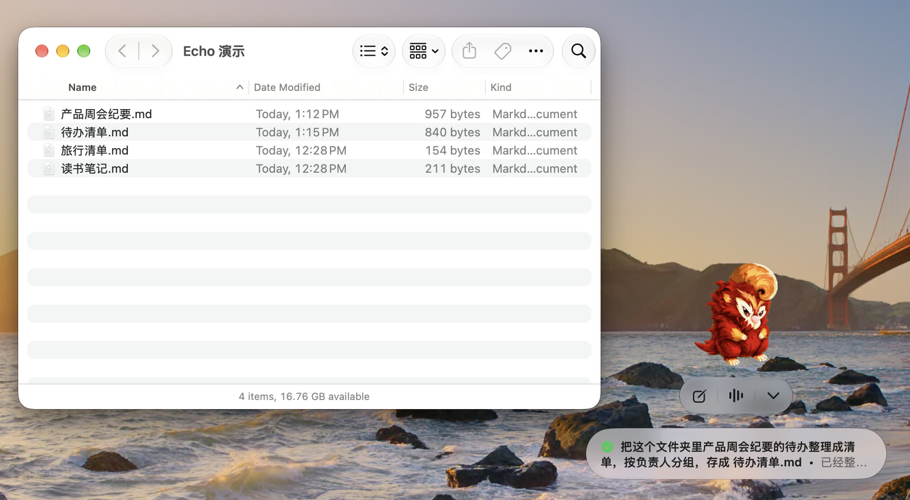
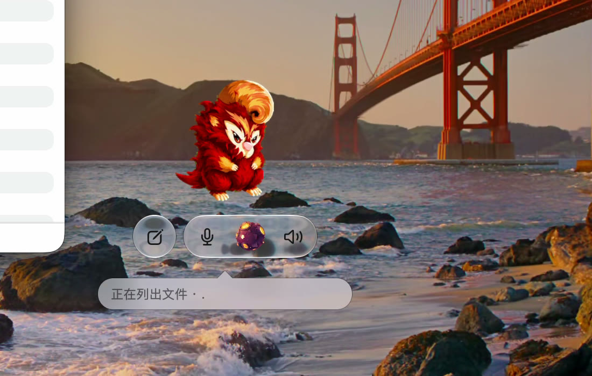
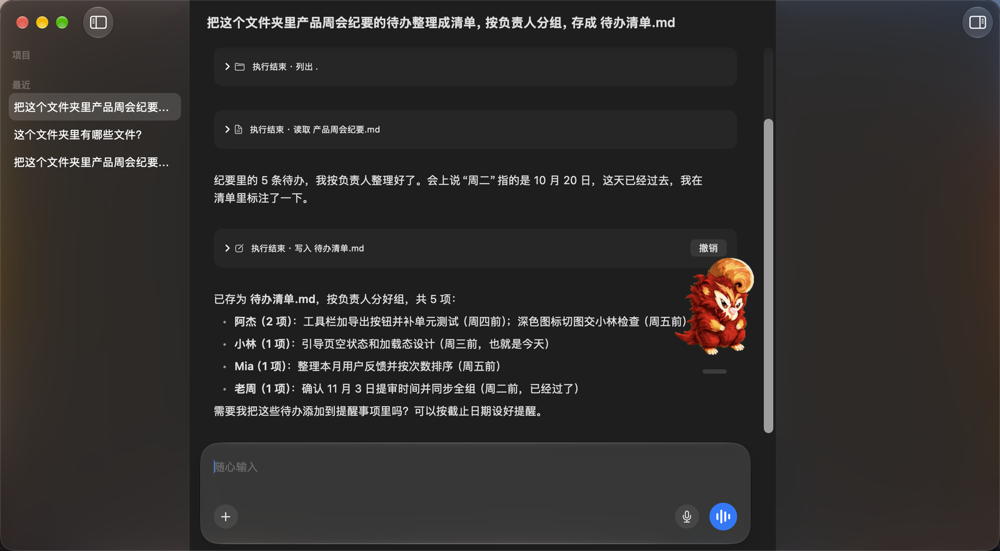
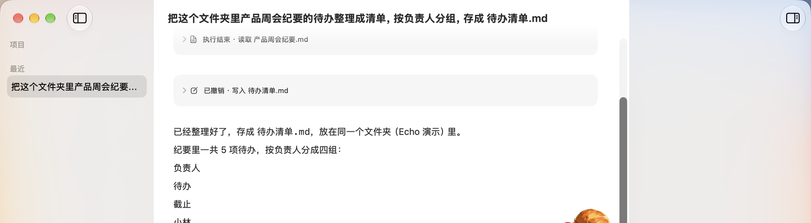
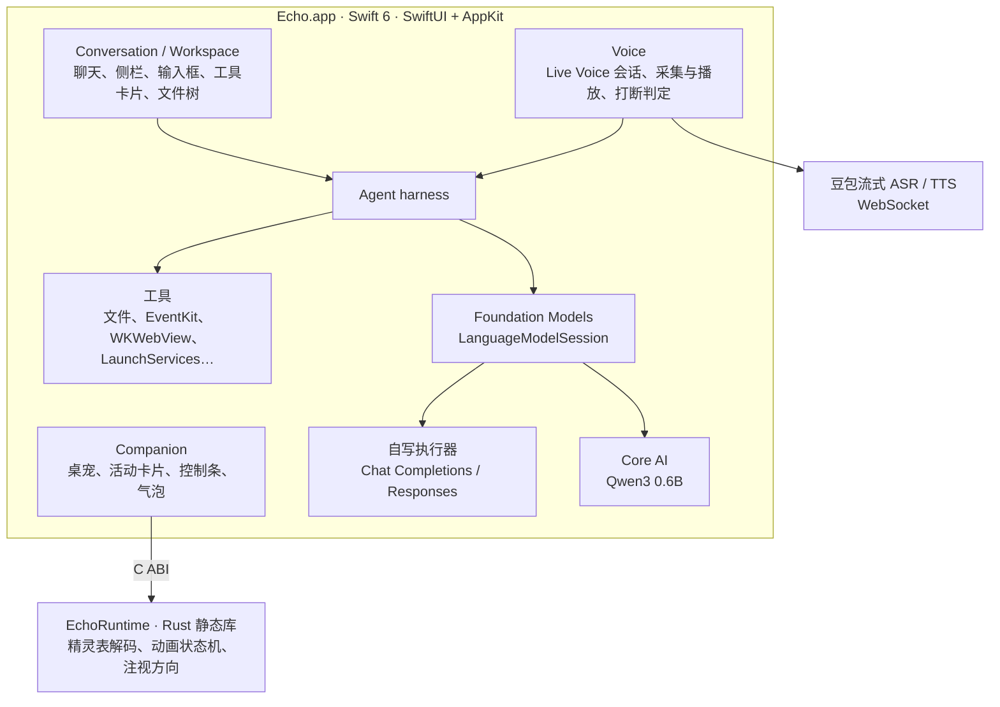

# Echo

简体中文 | [English](README.en.md)

Echo 是一个 macOS 原生桌宠，也是一个面向日常使用的轻量 Agent。界面用 SwiftUI 和 AppKit 写成，桌宠动画由一个小型 Rust 运行时驱动。

它常驻在桌面一角：平时跟着光标转头、被点击时挥手；交给它一件事，它在后台调工具做完，把结果放在桌宠旁边的卡片上；想说话时，开一通 Live Voice 就能持续语音对话。



<!-- 视频占位：30–60 秒演示 -->
> 🎬 演示视频待补：`docs/media/demo.mp4`

---

## 两种用法

**1. 交代任务，后台跑完**

点桌宠上的「新聊天」，或者在主窗口里发一条消息，Echo 会在后台调用工具完成任务。运行中桌宠播放任务动画，完成或失败时换成对应的动作；结果显示在桌宠旁的活动卡片上，可以直接在卡片里继续跟进、停止回复，或者打开完整聊天。也可以把文件夹拖到桌宠上，开一个以该文件夹为项目的新聊天；拖文本文件上去，则开一个带这些附件的新聊天。

**2. Live Voice，持续语音对话**

在桌宠或主窗口开始 Live Voice 后，Echo 持续听、持续答：语音识别结果实时进入对话，回复边生成边合成语音播放。回复播放中直接开口就能打断（barge-in）。通话期间，桌宠下方的控制条里（在主窗口里则是聊天界面中）会出现一颗星球，按连接中、聆听、思考、说话等状态播放不同动画；Agent 调工具时，气泡里会显示它正在做什么。



---

## 主要功能

**桌宠**
- 光标移动时转头看向光标，悬停时跳一下，点击时挥手并打开主窗口，可拖动、位置自动记住
- 任务开始、完成、失败各有动画；运行中和未查看的任务数显示为徽标
- 结果卡片支持继续跟进、停止回复、展开成列表、跳到对应聊天
- 内置两只精灵（赤焰、沧沧）和两颗 Live Voice 星球（烬星、静蓝星），也可以导入自定义的精灵和星球（兼容 Codex v2 桌宠格式）
- 菜单栏图标可随时叫回 Echo、显示或隐藏桌宠；支持快捷指令、Spotlight 里的 App Intents（显示/隐藏桌宠、开始 Live Voice、向 Echo 提问）

**主窗口**
- 侧栏按项目分组的聊天列表，原地改名、搜索面板快速跳转
- 检查器里的项目文件树：多选、预览（带语法高亮）、拖出到访达
- 输入框可以添加文件作为附件，支持系统听写（SpeechAnalyzer）
- 消息流里每次工具调用都是一张卡片，写入、提醒、日程、记忆等改动可以在卡片上撤销
- 界面支持中英文，跟随系统语言



**设置**
- 模型服务：DeepSeek、OpenAI、Ollama，或任意兼容 Chat Completions / Responses 的服务
- 火山方舟单独一组：一把 Key 同时用于 Live Voice、文生图，并可选用于对话和联网搜索
- 记忆页可查看、打开编辑或关闭记忆；精灵和星球页管理导入的形象
- API Key 存在钥匙串里

---

## Agent 工具

工具集以 `macos/Features/Agent/AgentHarness.swift` 的 `tools()` 为准。每个聊天只对应一个文件夹：有项目时是项目文件夹，没有项目时是访达当前显示的文件夹。

| 类别 | 工具 | 说明 |
| --- | --- | --- |
| 读文件 | `list_files`、`read_file` | 列目录、按行读文本；模型能看图时也读 PDF（按页转图）和 JPEG/PNG/GIF/WebP/HEIC 图片；也能读聊天附件 |
| 访达 | `finder_location` | 没有项目的聊天里，把聊天的文件夹切换到访达最前面窗口显示的位置 |
| 写文件 | `write_file`、`edit_file` | 整体写入或精确替换一段 UTF-8 文本；写之前自动备份，可撤销 |
| 提醒事项 | `list_reminders`、`create_reminder`、`complete_reminder` | 通过 EventKit 读写提醒事项，新建和完成可撤销 |
| 日历 | `list_events`、`create_event` | 读日程、在默认日历里建日程，新建可撤销 |
| 打开 | `open_app`、`open_url` | 按中英文名字打开应用，用默认浏览器打开 http(s) 网页 |
| 网页 | `web_fetch` | 本机用 WKWebView 加载网页，经 Readability + Turndown 抽取正文为 Markdown；PDF 用 PDFKit 取文字 |
| 搜索 | `web_search` | 用于对话的服务是火山方舟时走豆包搜索，是 DeepSeek 时走 DeepSeek 搜索，其他服务不提供 |
| 文生图 | `generate_image` | 豆包 Seedream 生图，默认存到「图片/Echo」，可撤销 |
| 记忆 | `remember`、`update_memory` | 往记忆文件里加一行、改一段；可撤销，并拦截敏感信息 |

没有网络时，尚未产生输出的一轮会自动改由本地模型回答；也可以设为始终只用本地模型。本地模型是用 Core AI 运行的 Qwen3 0.6B（4-bit），只聊天、不调工具。

---

## 设计取舍

**不做代码执行。** Echo 早期有 `bash` 工具，后来整个移除了。所有工具都是纯 Swift 实现，不启动任何进程；写文件工具拒绝写可执行文件（带 x 位）、`.terminal` 文件、`.app` 包内的文件和隐藏文件。没有任何工具能删除、重命名或移动文件。对“日常使用的 Agent”来说，能读能写文本已经覆盖大部分需求，而去掉代码执行能大幅缩小出错时的影响范围。

**写文件先备份，一键撤销。** 每次替换或修改文件前，原文件的字节、权限、创建时间、扩展属性和 ACL 都会存进这个聊天的备份目录，连同写入内容的 SHA-256 指纹。撤销时核对指纹，确认文件没被别人改过才恢复；新建的文件撤销时移到废纸篓。撤销之后，下一条消息前会附一段说明告诉模型哪些改动已经撤回，避免它基于过时的结果继续工作。提醒事项、日程、记忆和生成的图片同样可以撤销；打开应用和网页这类无法撤回的操作，工具说明里会明确告诉模型。



**记忆写入拦截敏感信息。** 记忆是 Echo 数据目录里的一个 Markdown 文件，每轮对话读一次放进指令里。模型通过 `remember` / `update_memory` 写入时，会按书写格式检查身份证号、银行卡号、手机号（数字要通过校验位才算）、密码、各家服务固定前缀的 API Key、邮箱和门牌级地址，命中就整条拒绝写入，并告诉模型原因。用户自己在编辑器里改记忆文件不受限制。

**同一批工具调用按顺序执行。** 模型一次发出多个调用时，读操作可以并行，但任何改动都要等它之前的调用全部完成，保证“先读再改”“先切换文件夹再读”的语义成立。

**插话不丢结果。** Agent 运行中用户再发消息，尚未开始的工具调用会标记为“被后续指令取代”而不执行，已完成的结果全部保留，新消息在下一次请求模型前插入。

**网络请求保守处理。** 模型请求不跟随重定向、不重试、响应上限 1 MiB；`web_fetch` 按解析后的 IP 拦截本机和局域网地址，子资源也不能访问本地网络；Live Voice 的 WebSocket 同样禁止重定向，避免带着凭据的请求被转走。

**能用系统的就用系统的。** 窗口、菜单、设置页、材质和 Liquid Glass 尽量走 AppKit / SwiftUI 的默认行为，不自绘；听写用 SpeechAnalyzer；提醒和日历用 EventKit；打开应用走 LaunchServices；对外暴露能力用 App Intents。

---

## 技术架构



- **Agent**：工具循环由 Apple 的 Foundation Models 框架驱动。Echo 为 OpenAI 兼容服务写了自己的 `LanguageModel` 执行器，每次 `respond` 只发一个 HTTP 请求，把 transcript 映射到 Chat Completions 或 Responses 协议，流式文本实时推给界面，并处理 DeepSeek 思考模式要求回放 reasoning 等服务差异。
- **状态**：所有 store 使用 `@Observable`；工作区、每个聊天和设置各自以 JSON 存在 Application Support。
- **语音**：麦克风和播放基于 AVAudioEngine，开启系统的语音处理（回声消除）；本地能量门控先暂停播放，再由新的识别文本确认是否真的被打断，避免把扬声器回声当成插话。
- **桌宠运行时**：`runtime/` 是 Rust 写的静态库，经 C 头文件 `runtime/include/echo_runtime.h` 暴露给 Swift。它解码 WebP 精灵表，按优先级决定当前显示的动画（拖动 > 单次动作 > 注视 > 基础状态），并告诉 Swift 下一帧何时唤醒，静止时不跑计时器。动画格式与时序参考了 openai/codex 的终端桌宠实现。
- **测试**：约 500 个 Swift 测试（Swift Testing 与 XCTest）加 Rust 单元测试，分为日常跑的 EchoTests、需要前台和真实按键的 EchoAppTests、连真实服务的 EchoLiveTests 三个测试计划。模型服务用本机回环假服务器和脚本化模型替身，测试不依赖网络、键盘布局或输入法。

代码规模约 2.5 万行 Swift 和 1300 行 Rust。

```
macos/
  App/            入口、主窗口、菜单栏图标、菜单命令、App Intents
  Features/
    Agent/        harness、模型执行器、全部工具、撤销与备份、记忆
    Companion/    桌宠窗口、活动卡片、控制条、精灵与星球目录
    Conversation/ 聊天视图、输入框、工具卡片、侧栏、搜索面板
    Voice/        Live Voice 会话、音频、协议、打断
    Dictation/    系统听写
    ProjectBrowser/ 项目文件树与预览
    Settings/     设置窗口与存储
    Workspace/    聊天、项目与持久化
runtime/          Rust 桌宠动画运行时
assets/           图标、内置精灵与星球、本地化字符串
tests/            单元、视图、集成与 UI 测试
TestPlans/        三个测试计划
```

---

## 模型服务

| 用途 | 服务 |
| --- | --- |
| 对话（默认） | DeepSeek；也可选 OpenAI、Ollama 或任意兼容服务 |
| 对话（可选） | 火山方舟 Agent Plan，默认 `doubao-seed-2.0-mini`，走 Responses 协议 |
| Live Voice | 豆包流式语音识别（Seed ASR）与双向流式语音合成（Seed TTS 2.0），使用火山方舟 Key |
| 联网搜索 | 豆包搜索或 DeepSeek 搜索，随“用于对话”的服务切换 |
| 文生图 | 豆包 Seedream，默认 `doubao-seedream-5.0-pro` |
| 离线 | 本地 Qwen3 0.6B（Core AI） |

已知能看图的模型（目前是 `doubao-seed-2.0-mini` 和 `deepseek-flash`）会收到 PDF 页面和图片，并按各家服务的请求大小和上下文上限分批；其他模型只读文本。

---

## 运行环境与构建

**环境要求**
- Apple 芯片的 Mac，macOS 27 或更新
- Xcode 27.1 或更新
- Rust 工具链（通过 rustup 安装，需要 `aarch64-apple-darwin` 目标）
- 一个 Apple Development 签名证书

**构建步骤**

1. 克隆仓库，用 Xcode 打开 `Echo.xcodeproj`。Swift Package 依赖 [coreai-models](https://github.com/houbaoshu/coreai-models) 会自动拉取。
2. 在 `Echo.xcconfig` 里把 `DEVELOPMENT_TEAM` 改成你自己的团队 ID。全部构建设置集中在这个文件里，`project.pbxproj` 只保留结构。
3. 选择 `Echo` scheme，构建运行。Rust 静态库由构建阶段的 `scripts/xcode-cargo-build.sh` 自动编译。
4. 首次启动后，在设置的「模型」页填写模型服务的 API Key；要用 Live Voice、文生图或豆包搜索，再填写火山方舟的 Key。

**可选：本地模型**

把导出好的 Core AI 模型目录装到 Echo 的数据目录：

```sh
scripts/install-local-model.sh /path/to/qwen3_0_6b_4bit_dynamic
```

**运行测试**

在 Xcode 里选 `Echo` scheme 运行测试，跑的是默认测试计划 EchoTests。需要前台焦点和真实按键的测试在 `Echo-App` scheme，连接真实服务的测试在 `Echo-Live` scheme。

---

## 致谢

- 桌宠动画格式和时序参考 [openai/codex](https://github.com/openai/codex) 的终端桌宠
- 网页正文抽取使用 Mozilla [Readability](https://github.com/mozilla/readability)、[Turndown](https://github.com/mixmark-io/turndown) 及其 GFM 插件
